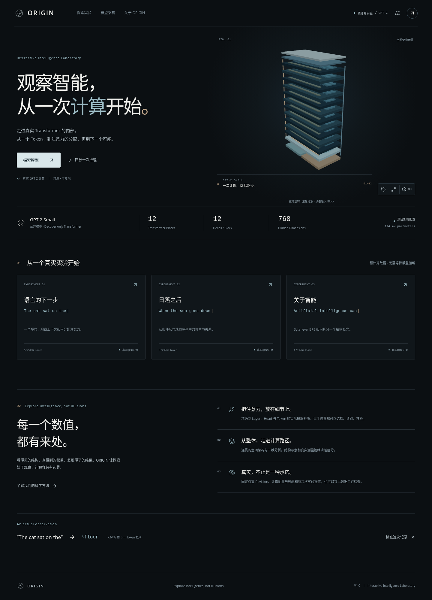

# ORIGIN

**Interactive Intelligence Laboratory — Explore intelligence, not illusions.**

一个默认中文的 Transformer 交互式科学实验室。用真实 GPT-2 前向计算观察 Token、Attention、Residual Stream 和下一 Token 概率。静态版本完全独立于 Python 服务；实时模式可以分析新文本。



## 已实现

- 完整首页、三组真实预计算实验、数据来源与 JSON 导出。
- Byte-level BPE Token ID、解码、原始片段、UTF-8 字节与特殊 Token 标识。
- 12 层 × 12 Head 的真实 Attention，Query / Key 选择、因果遮罩、精确矩阵和关联视图。
- 语义组件三维架构、相机聚焦、二维完整架构与 Block 内部路径。
- 所有位置的 Top-8 下一 Token 预测、原始 Logit、完整词表概率、剩余概率质量。
- 记录数据的分步推理回放、逐层每个 Token 的 L2 / RMS。
- 手机触控布局、可展开信息面板、键盘操作、降低动态效果、WebGL 降级。
- 有输入上限、单请求计算锁、超时和限流的本地 FastAPI。

模型是研究样本，不代表现代最先进模型能力。注意力不是单独的因果证据；激活幅度不是理解程度；空间结构是组件示意。

## 环境

已在 Linux x86_64、Node.js 24.22.1、npm 11.9.0、Python 3.12.14、uv 0.13.4、CPU 上验证。建议给模型服务至少 2 GB 内存；安装与缓存需要额外磁盘。Python 依赖通过 `uv.lock` 锁定，PyTorch 使用 CPU wheel，权重不会提交到 Git。

前端：React 19、严格 TypeScript、Vite 8、Three.js、React Three Fiber、Drei、GSAP、Zustand、SVG / Canvas、Ajv。后端：FastAPI、Pydantic、PyTorch 2.10.0+cpu、Transformers 5.22.1、TransformerLens 4.3.0。

## 静态实验模式

```bash
npm ci
npm run dev
```

打开终端打印的 `http://127.0.0.1:5173/`。无需安装 Python，也无需下载模型。预计算 JSON 在 `apps/web/public/data/`，运行时按需读取并校验文件长度、SHA-256（安全上下文）和数据协议。

## 实时分析模式

在另一个终端：

```bash
cd services/model-api
uv sync --frozen
HF_HUB_DISABLE_XET=1 uv run uvicorn app.main:app --host 127.0.0.1 --port 8000
```

第一次启动会下载公开 GPT-2 权重。检查 `http://127.0.0.1:8000/api/health` 的 `model_ready`；前端切换“实时分析”并提交短文本。默认连接 `http://127.0.0.1:8000`。可在 `apps/web/.env.local` 中设置 `VITE_API_URL`，修改后重启前端。

模型固定为 `openai-community/gpt2@607a30d783dfa663caf39e06633721c8d4cfcd7e`，最多 64 个**实际 Token**。不静默截断。服务不可用时不会生成新结果；可返回预计算实验。

配置参见 [.env.example](.env.example)。API 文档在 `/docs`；默认仅监听 loopback。内存缓存最多保留 8 次输入与结果，进程退出即清空；应用不记录输入正文。

## 复现真实数据与类型

```bash
cd services/model-api
PYTHONPATH=. HF_HUB_DISABLE_XET=1 uv run python scripts/verify_model.py
PYTHONPATH=. uv run python scripts/export_schema.py
PYTHONPATH=. HF_HUB_DISABLE_XET=1 uv run python scripts/generate_fixtures.py
cd ../..
npm run schema:types
```

Python Pydantic 模型是协议的唯一来源。导出的 JSON Schema 与自动生成的 TypeScript 类型一并提交。禁止手工修改生成的类型。生成器在写入正式实验前执行结构和科学数值校验。

## 验证

```bash
npm run check
npm run lint
npm test
npm run build
npm run test:e2e
cd services/model-api
uv run ruff check app tests scripts
uv run ruff format --check app tests scripts
HF_HUB_DISABLE_XET=1 uv run pytest -q
```

Playwright 默认使用已安装的 `/usr/bin/chromium`，否则先执行 `npx playwright install --with-deps chromium`。API 已就绪时，在仓库根目录执行 `ORIGIN_LIVE_TEST=1 npm run test:e2e`，运行真实实时分析及 64 Token 测试。未设置该变量时这些测试会明确跳过，不计为通过。

完整实测记录见 [testing.md](docs/testing.md)、[performance.md](docs/performance.md) 和 [acceptance.md](docs/acceptance.md)。

## 构建与部署

```bash
# 普通静态托管
npm run build

# 仓库子路径
VITE_BASE_PATH=/origin-ai-lab/ npm run build
python scripts/serve-pages.py
```

第二种方式访问 `http://127.0.0.1:4180/origin-ai-lab/`。Hash 导航可直接刷新，不需要服务端 SPA 重写。产物为 `apps/web/dist/`，Python 不在静态部署链路中。

GitHub Pages 工作流已准备在 `.github/workflows/pages.yml`，需由仓库拥有者配置远程仓库、开启 Pages 的 Actions 来源后手动运行。**源码现已推送至 https://github.com/jiangjinzhou01-ctrl/origin-ai-lab ，云端完整 CI 已通过。Pages 首次启用仍需要仓库设置；网站尚未发布成功。** 最新状态见 [GitHub 部署记录](docs/github-deployment.md)。 详细操作见 [deployment.md](docs/deployment.md)。

## 结构

```text
apps/web/src/features/       Token / Attention / Architecture / Inference
apps/web/src/scenes/         按需加载的三维模块
apps/web/src/visualization/  精确二维矩阵
apps/web/src/store/          统一选择与回放状态
apps/web/public/data/        真实实验与校验清单
services/model-api/app/      模型内核、协议、API
services/model-api/scripts/  技术验证、Schema、数据导出、性能测量
services/model-api/tests/    单元、并发与真实模型集成测试
schemas/                    生成的共享 JSON Schema
scripts/                    静态部署模拟、许可证和浏览器测量
docs/                       架构、科学方法、来源、测试与验收证据
.github/workflows/          CI、真实模型测试、Pages 部署
```

## 边界与维护

V1 仅支持固定 GPT-2、CPU 为默认设备、短文本、单服务实例。Comparison Lab 属于 P1，尚未实现。没有账号、训练、任意模型上传或因果干预。三维代码块约 975 KB（gzip 约 272 KB），只在需要三维时加载；小屏和降低动态效果模式不请求该模块。

实测浏览器是 Chromium；移动测试为视口 / 触控模拟，尚未对物理手机、Safari、Firefox 或生产云环境给出性能承诺。公开实时 API 还需要 HTTPS、网关、全局限流与运营配置；内置限流只作用于单进程。

项目代码 MIT。模型 MIT。GSAP 使用其 Standard No Charge License，不能把它称为 MIT / OSI 开源许可证。其余依赖和素材说明见 [licenses.md](docs/licenses.md)，分发产物保留第三方许可文本。
