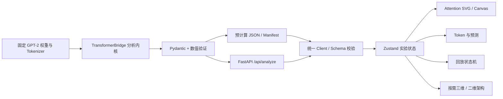

# 工程架构

ORIGIN 将“模型计算”“实验数据”“交互选择”“显示动画”分开。所有正式数据来自实际权重；动画只读取完成的实验。

## 前端

React + 严格 TypeScript，按功能组织。`data/client.ts` 先验证协议，再校验轴、Attention、激活和概率质量；静态文件另有 Manifest 长度及 SHA-256 校验。所有资源使用 Vite BASE_URL，Hash 用于主页面导航。

`store/lab.ts` 是唯一业务状态：数据模式、实验、Layer、Head、Query、Key、组件、镜头修订号、回放步骤、播放状态及请求状态。实验数据与选中索引分离，业务中不修改原始矩阵。切换实验会归一化索引并停止播放；请求有 AbortController 与递增代号，旧响应无法覆盖新实验。

图层编号统一零基。组件使用稳定语义 ID，例如 `block-5.attention`；组件选择、矩阵和镜头从同一 Layer 读取。相机动画不能修改 Attention 数据。

小矩阵使用 SVG，超过 16 Token 使用 Canvas 2D；两者均有 Query / Key 控件及完整行数据表作为非图形读取方式。预测依据当前 Query 位置，只使用该位置及之前的上下文。

三维由 React.lazy 加载。语义 Block 和 Head 使用 InstancedMesh；非实例化实体数量有限。Canvas 使用 demand frame loop、DPR ≤ 1.5、低功耗偏好；没有后处理或持续粒子。GSAP 只负责有终点的相机过渡，用户拖拽会中断 tween。R3F 管理几何和材质生命周期，组件清理事件监听与 tween。WebGL 丢失时回退二维。

小屏默认二维，以矩阵为主，Token 横向滚动，预测及模型信息放进可展开面板。降低动态效果会停止自动回放并使用二维架构，手动步骤仍可访问。

## 后端

`ModelEngine` 在进程生命周期内只加载一次固定权重，显式 CPU / float32 / eval / inference_mode，Bridge 使用 eager attention。只缓存所需 Hook，不存储完整神经元激活供前端使用。

FastAPI 在后台线程加载模型，健康接口始终能够响应。推理也在线程执行，但单一异步锁保证 Bridge 的 Hook 状态不被并发修改。忙时返回 429。HTTP 等待超过 45 秒返回结构化 504，后台任务继续占用锁直到真实计算结束，避免超时释放锁后产生重入。

请求体有 16 KiB 限制；UTF-8 文本上限 8192 字节；Tokenizer 后最多 64 Token；模型 ID 与 top_k 采用白名单和范围验证。内存 LRU 最多 8 个结果，结果深拷贝后标记缓存命中，统计耗时仍指原始记录。限流为每客户端每分钟 12 次，单进程实现。

API 不接受文件路径、模型下载 URL 或代码。CORS 为明确白名单。默认 loopback；公开部署前由反向代理提供 TLS、全局配额与额外请求限制。

## 协议

唯一来源为 `services/model-api/app/serializers/schema.py`。导出 `schemas/origin.analysis.v1.json` 后，`scripts/generate-types.mjs` 将 tuple 的 schema 方言转换为类型生成器支持的格式，不重新定义字段。CI 检查生成物差异。

`origin.analysis.v1` 包含 input、model、runtime、tokens、architecture、attention、activation_summaries、next_token_predictions、provenance。Attention 的轴明确定义为 `[layer, head, query, key]`，激活张量为 `[1, sequence, hidden]`。不会把 Python Tensor 直接序列化。

静态与实时使用完全相同的 Analysis。`source_mode` 表示计算记录来源；用户当前选择的数据模式是独立状态。实时请求失败时保留上次记录并清楚显示来源，不把旧数据解释为新结果。
